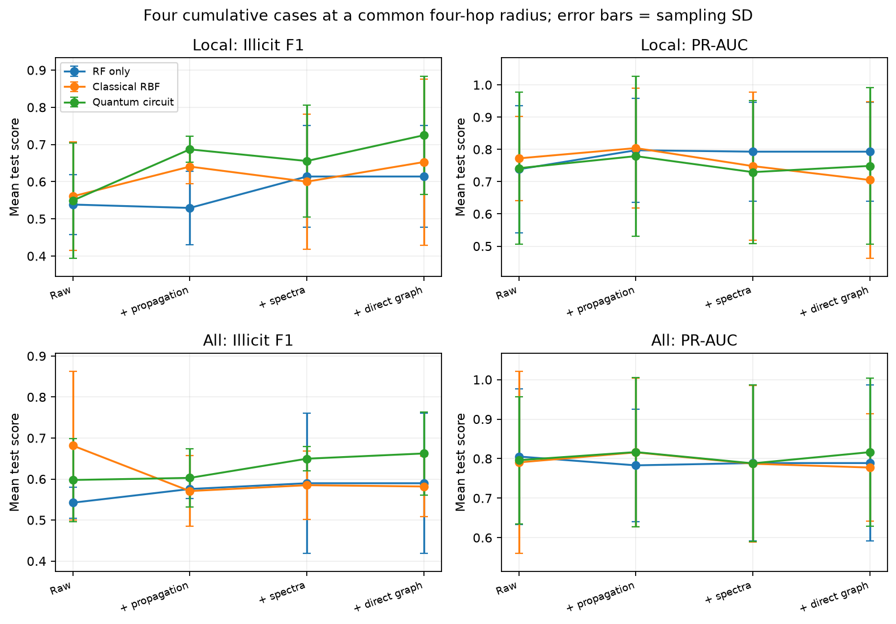
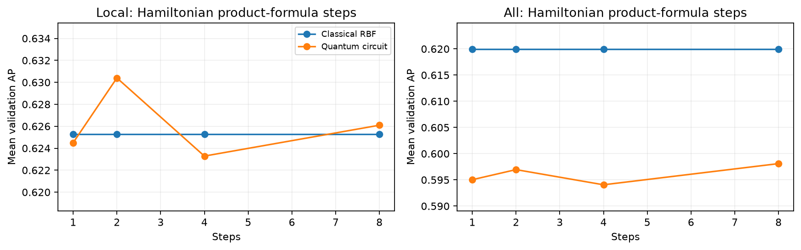

# Q-Ripple: four cumulative graph-risk comparisons

Can added graph information improve illicit transaction detection, and does a quantum representation improve on a matched classical one? [experiment_flow.ipynb](experiment_flow.ipynb), the README and the [six-slide PDF](output/pdf/q_ripple_research_summary.pdf) now use **the same four cases for Local 93 and All 165**. [Speaking notes](output/pdf/q_ripple_three_minute_narration.txt) fit within three minutes.

## Dataset and task

Elliptic contains 203,769 Bitcoin transaction nodes and 234,355 directed Bitcoin-flow edges over 49 time steps. There are 4,545 illicit, 42,019 licit and 157,205 unknown-label transactions. We predict illicit versus licit and rank risk on held-out labelled transactions. Unknown-label nodes supply graph context, not negative test labels. The three local CSVs and their exact hashes are described in [data/manifest.json](data/manifest.json).

Local uses 93 root attributes. All adds 72 supplied neighborhood aggregates, so it already contains graph information. The time-step field controls chronological splitting and is excluded from these 93/165 numerical inputs. Dataset source: [Elliptic](https://www.kaggle.com/datasets/ellipticco/elliptic-data-set).

## Four cases and their controls

| Case | Complete numerical RF input | Classical RBF branch | Quantum branch |
|---|---|---|---|
| 1. Raw attributes | Local 93 / All 165 | Same attributes | Re-uploading circuit on those attributes |
| 2. + Propagation | Case 1 + unencoded full-period risk/structural/walk descriptors | Same propagation vector | Re-uploading circuit on that vector |
| 3. + Spectral topology | Case 2 + **unencoded spectral/topology descriptors** | Same spectral vector | Re-uploading circuit on that vector |
| 4. + Direct topology | **Entire case-3 vector retained** | Packed adjacency and root/seed-marker RBF | Edges determine Hamiltonian interactions |

Every case has **RF only**, **Classical RBF + RF**, and **Quantum circuit + RF**. RF-only controls stay visible even when another model wins validation AP. Raw RF has no literal quantum-Random-Forest counterpart: its paired quantum arm uses the same raw attributes with a quantum kernel and the same classical RF readout. “Equivalent” means matched information, roots, landmarks and classifier settings, not identical kernel functions.

**Spectral features are numerical topology features.** The vector combines motif/degree/walk statistics, adjacency eigenvalues, directed singular values and root return walks. A generic quantum rotation circuit sees that description. In case 4, actual graph edges instead determine interactions in a Hamiltonian circuit. Both final kernel arms still retain the full unencoded spectral vector, so the experiment adds a direct-graph representation without discarding numerical topology.

**Three different questions:** RF-only comparisons assess added numerical information. Within-case RF/RBF/circuit comparisons assess representation value. Noiseless versus IBM execution assesses how device execution changes the final circuit. The last question is secondary to whether using the circuit helps against non-circuit controls.

## Matched evaluation

- All simulator cases share the same chronological roots: 80 train, 60 validation and 100 test per seed, over seeds 42/43/44. Train on periods 1–30, validate on 31–34 and test on 35–49.
- Cases 2–4 use a **common four-hop radius**. Sampled topology has an eight-node budget. Full-period propagation is not truncated to those eight nodes.
- Graph experiments reveal a fixed 20% of period-local illicit labels as known seeds. All cases exclude seeds from evaluation and retain unknown nodes as context. Full-period connectivity is assumed available. This is seed-assisted discovery, not online edge-arrival evaluation.
- All numerical features bypass the approximate kernel branches unchanged. Fit angular preprocessing on training data only. Each kernel uses the same 12 training landmarks and a matching RF with 150 trees, minimum leaf size 5 and balanced subsampling.
- Numerical quantum maps try one/two re-uploading passes on four qubits. Hamiltonian circuits try **1/2/4/8 product-formula steps** at fixed time 0.8 and four-hop radius. These simulator runs have been executed. More steps refine evolution accuracy, rather than increasing the hop radius.
- Mean validation AP selects the quantum configuration within each case and feature set. Its exact classical RBF counterpart remains alongside it. Passes/steps on the RBF row identify the quantum setting it accompanies; RBF has no quantum circuit depth. RF-only rows require no kernel configuration.
- All five test metrics appear in every classification table. Accuracy measures correctness; balanced accuracy averages class recalls; illicit F1 combines positive precision and recall at the RF decision rule. PR-AUC means average precision (AP), and ROC-AUC measures ranking. F1 and AP answer different questions. AP depends on prevalence. Sampling SD is not a confidence interval.

## Main simulator results

These are the **new cumulative four-hop results**. Earlier results searched radii independently and did not retain spectra in the direct-topology RF bypass. Those older scores remain in `01_*`–`06_*` CSVs but are not mixed into these tables or slides. In particular, the earlier 0.7591 F1 and 0.9444 hardware AP are not the scores for the revised cumulative readouts.

### Local 93

<!-- BEGIN LOCAL_CASES -->
| Case | Arm | Model | Setting | Accuracy | Balanced accuracy | Illicit F1 | PR-AUC | ROC-AUC |
|---|---|---|---|---|---|---|---|---|
| 1 Raw attributes | RF only | Raw RF | raw attributes | 0.9267 | 0.8667 | 0.5385 | 0.7383 | 0.8940 |
| 1 Raw attributes | Classical RBF | RF + RBF attributes | raw attributes; passes=1 | 0.9300 | 0.8684 | 0.5606 | 0.7722 | 0.8702 |
| 1 Raw attributes | Quantum circuit | RF + quantum attributes | raw attributes; passes=1 | 0.9367 | 0.8404 | 0.5493 | 0.7417 | 0.8653 |
| 2 + Propagation | RF only | RF + propagation | 4 hops | 0.9200 | 0.8632 | 0.5294 | 0.7973 | 0.8772 |
| 2 + Propagation | Classical RBF | RF + RBF propagation | 4 hops; passes=1 | 0.9533 | 0.8807 | 0.6405 | 0.8040 | 0.8912 |
| 2 + Propagation | Quantum circuit | RF + quantum propagation | 4 hops; passes=1 | 0.9633 | 0.8860 | 0.6869 | 0.7790 | 0.8898 |
| 3 + Spectral topology | RF only | RF + propagation + spectra | 4 hops | 0.9400 | 0.8737 | 0.6139 | 0.7929 | 0.8821 |
| 3 + Spectral topology | Classical RBF | RF + RBF spectra | 4 hops; passes=2 | 0.9500 | 0.8474 | 0.6000 | 0.7482 | 0.8933 |
| 3 + Spectral topology | Quantum circuit | RF + quantum spectra | 4 hops; passes=2 | 0.9633 | 0.8544 | 0.6556 | 0.7295 | 0.8877 |
| 4 + Direct topology | RF only | RF + propagation + spectra | 4 hops | 0.9400 | 0.8737 | 0.6139 | 0.7929 | 0.8821 |
| 4 + Direct topology | Classical RBF | RF + adjacency RBF | 4 hops; steps=2 | 0.9600 | 0.8526 | 0.6528 | 0.7052 | 0.8800 |
| 4 + Direct topology | Quantum circuit | RF + Hamiltonian circuit | 4 hops; steps=2 | 0.9733 | 0.8596 | 0.7249 | 0.7488 | 0.8807 |
<!-- END LOCAL_CASES -->

### All 165

<!-- BEGIN ALL_CASES -->
| Case | Arm | Model | Setting | Accuracy | Balanced accuracy | Illicit F1 | PR-AUC | ROC-AUC |
|---|---|---|---|---|---|---|---|---|
| 1 Raw attributes | RF only | Raw RF | raw attributes | 0.9333 | 0.8702 | 0.5423 | 0.8054 | 0.8779 |
| 1 Raw attributes | Classical RBF | RF + RBF attributes | raw attributes; passes=1 | 0.9567 | 0.8825 | 0.6815 | 0.7905 | 0.8772 |
| 1 Raw attributes | Quantum circuit | RF + quantum attributes | raw attributes; passes=1 | 0.9467 | 0.8772 | 0.5977 | 0.7961 | 0.8716 |
| 2 + Propagation | RF only | RF + propagation | 4 hops | 0.9400 | 0.8737 | 0.5757 | 0.7830 | 0.8737 |
| 2 + Propagation | Classical RBF | RF + RBF propagation | 4 hops; passes=1 | 0.9367 | 0.8719 | 0.5707 | 0.8159 | 0.8744 |
| 2 + Propagation | Quantum circuit | RF + quantum propagation | 4 hops; passes=1 | 0.9433 | 0.8754 | 0.6028 | 0.8167 | 0.8730 |
| 3 + Spectral topology | RF only | RF + propagation + spectra | 4 hops | 0.9433 | 0.8754 | 0.5897 | 0.7888 | 0.8821 |
| 3 + Spectral topology | Classical RBF | RF + RBF spectra | 4 hops; passes=1 | 0.9433 | 0.8754 | 0.5850 | 0.7871 | 0.8730 |
| 3 + Spectral topology | Quantum circuit | RF + quantum spectra | 4 hops; passes=1 | 0.9567 | 0.8825 | 0.6496 | 0.7881 | 0.8751 |
| 4 + Direct topology | RF only | RF + propagation + spectra | 4 hops | 0.9433 | 0.8754 | 0.5897 | 0.7888 | 0.8821 |
| 4 + Direct topology | Classical RBF | RF + adjacency RBF | 4 hops; steps=8 | 0.9467 | 0.8456 | 0.5818 | 0.7775 | 0.8744 |
| 4 + Direct topology | Quantum circuit | RF + Hamiltonian circuit | 4 hops; steps=8 | 0.9600 | 0.8842 | 0.6623 | 0.8164 | 0.8814 |
<!-- END ALL_CASES -->



**What the controls show.** Adding propagation raises Local RF-only AP from **0.7383 to 0.7973**. Adding spectral features raises Local RF-only F1 from **0.5294 to 0.6139**, and All RF-only F1 from **0.5757 to 0.5897**. Case-4 RF-only repeats case 3 exactly because its numerical inputs are unchanged.

**Direct-circuit versus matched adjacency RBF.** Local F1 changes **0.6528 to 0.7249** and AP **0.7052 to 0.7488**. All F1 changes **0.5818 to 0.6623** and AP **0.7775 to 0.8164**. Thus the direct circuit improves both F1 and AP over its matched RBF control for both feature sets in this pilot.

**Compare with the other controls too.** Local direct-circuit AP (**0.7488**) remains below spectral RF-only AP (**0.7929**). All attribute RBF F1 (**0.6815**) remains above All direct-circuit F1 (**0.6623**). A matched-kernel gain therefore does not establish superiority over every classical model. The full progression and all five metrics remain visible rather than selecting a favorable metric or omitting a strong baseline.



## IBM cohort: circuit versus the non-circuit alternatives

All four cases are also fitted on the **same recorded balanced 12/8/12 train/validation/test roots**, for Local and All. Attribute/propagation/spectral quantum branches are simulator-only. **Only the final graph-dependent circuit has IBM measurements**, reusing the completed `ibm_fez` jobs, four recorded landmarks and four product-formula steps. The table distinguishes classical models, noiseless circuit simulation and IBM measurement; ideal-versus-IBM is no longer the headline comparison.

The graph circuits excluded numerical node attributes, so their stored similarities can be reused with both Local/All attributes and the new retained spectral inputs. Reanalysis changes the classical RF readout, not the measured quantum circuits. **No new hardware jobs were submitted.** The original 8-qubit fidelity and separate 40-qubit observable jobs total 52 charged QPU seconds.

<!-- BEGIN HARDWARE_CASES -->
| Case | Features | Arm | Execution | Setting | Accuracy | Balanced accuracy | Illicit F1 | PR-AUC | ROC-AUC |
|---|---|---|---|---|---|---|---|---|---|
| 1 Raw attributes | Local | RF only | Classical | raw attributes | 0.6667 | 0.6667 | 0.7143 | 0.9167 | 0.8472 |
| 1 Raw attributes | Local | Classical RBF | Classical | raw attributes; passes=1 | 0.6667 | 0.6667 | 0.7143 | 0.8357 | 0.8056 |
| 1 Raw attributes | Local | Quantum circuit | Noiseless simulator | raw attributes; passes=1 | 0.6667 | 0.6667 | 0.7143 | 0.8357 | 0.8056 |
| 1 Raw attributes | All | RF only | Classical | raw attributes | 0.7500 | 0.7500 | 0.7692 | 0.9583 | 0.9444 |
| 1 Raw attributes | All | Classical RBF | Classical | raw attributes; passes=1 | 0.7500 | 0.7500 | 0.6667 | 0.7827 | 0.6667 |
| 1 Raw attributes | All | Quantum circuit | Noiseless simulator | raw attributes; passes=1 | 0.7500 | 0.7500 | 0.6667 | 0.8631 | 0.8056 |
| 2 + Propagation | Local | RF only | Classical | 4 hops | 0.6667 | 0.6667 | 0.7143 | 0.6190 | 0.5972 |
| 2 + Propagation | Local | Classical RBF | Classical | 4 hops; passes=1 | 0.6667 | 0.6667 | 0.7143 | 0.8135 | 0.7639 |
| 2 + Propagation | Local | Quantum circuit | Noiseless simulator | 4 hops; passes=1 | 0.6667 | 0.6667 | 0.7143 | 0.8135 | 0.7639 |
| 2 + Propagation | All | RF only | Classical | 4 hops | 0.8333 | 0.8333 | 0.8333 | 0.9167 | 0.8889 |
| 2 + Propagation | All | Classical RBF | Classical | 4 hops; passes=1 | 0.6667 | 0.6667 | 0.7143 | 0.8542 | 0.7917 |
| 2 + Propagation | All | Quantum circuit | Noiseless simulator | 4 hops; passes=1 | 0.6667 | 0.6667 | 0.7143 | 0.8542 | 0.7917 |
| 3 + Spectral topology | Local | RF only | Classical | 4 hops | 0.7500 | 0.7500 | 0.7692 | 0.8302 | 0.8056 |
| 3 + Spectral topology | Local | Classical RBF | Classical | 4 hops; passes=1 | 0.6667 | 0.6667 | 0.7143 | 0.7040 | 0.7500 |
| 3 + Spectral topology | Local | Quantum circuit | Noiseless simulator | 4 hops; passes=1 | 0.6667 | 0.6667 | 0.7143 | 0.7183 | 0.7222 |
| 3 + Spectral topology | All | RF only | Classical | 4 hops | 0.6667 | 0.6667 | 0.7143 | 0.8357 | 0.7917 |
| 3 + Spectral topology | All | Classical RBF | Classical | 4 hops; passes=2 | 0.6667 | 0.6667 | 0.5000 | 0.6742 | 0.5278 |
| 3 + Spectral topology | All | Quantum circuit | Noiseless simulator | 4 hops; passes=2 | 0.4167 | 0.4167 | 0.2222 | 0.5985 | 0.5000 |
| 4 + Direct topology | Local | RF only | Classical | 4 hops | 0.7500 | 0.7500 | 0.7692 | 0.8302 | 0.8056 |
| 4 + Direct topology | Local | Classical RBF | Classical | 4 hops; steps=4 | 0.6667 | 0.6667 | 0.7143 | 0.7040 | 0.7361 |
| 4 + Direct topology | Local | Quantum circuit | Noiseless simulator | 4 hops; steps=4 | 0.6667 | 0.6667 | 0.7143 | 0.7040 | 0.7361 |
| 4 + Direct topology | Local | IBM circuit | IBM measured | 4 hops; steps=4 | 0.7500 | 0.7500 | 0.7273 | 0.8708 | 0.8333 |
| 4 + Direct topology | All | RF only | Classical | 4 hops | 0.6667 | 0.6667 | 0.7143 | 0.8357 | 0.7917 |
| 4 + Direct topology | All | Classical RBF | Classical | 4 hops; steps=4 | 0.6667 | 0.6667 | 0.5000 | 0.6557 | 0.5000 |
| 4 + Direct topology | All | Quantum circuit | Noiseless simulator | 4 hops; steps=4 | 0.6667 | 0.6667 | 0.5000 | 0.6557 | 0.5000 |
| 4 + Direct topology | All | IBM circuit | IBM measured | 4 hops; steps=4 | 0.7500 | 0.7500 | 0.7692 | 0.9167 | 0.8889 |
<!-- END HARDWARE_CASES -->

**What improves, and against which baseline?** The IBM circuit's AP is **0.8708 Local / 0.9167 All**, versus adjacency-RBF AP **0.7040 / 0.6557**. However, raw RF AP is **0.9167 / 0.9583**, which is higher. All propagation RF also has higher F1 than the IBM circuit. Including these alternatives changes the interpretation: the circuit beats its matched topology-kernel control here, but does not beat all non-circuit alternatives.

Balanced prevalence differs from the main simulator cohort, so compare AP **within** this hardware cohort. Twelve test examples and one measured run do not establish statistical significance or reliability. Earlier IBM scores are preserved as historical results, not substituted into the revised cumulative comparison.

## Run and reproduce

The repository is `q-ripple-elliptic`. Python 3.12 and an independent `.venv` are provided. From the repository root:

```sh
uv sync --frozen
uv run python -m ipykernel install --prefix .venv --name q-ripple-elliptic --display-name "Python (Q-Ripple Elliptic)"
uv run python -m jupyterlab experiment_flow.ipynb
```

Select **Python (Q-Ripple Elliptic)**. Direct dependencies and transitive versions are pinned in `pyproject.toml` / `uv.lock`; `requirements.txt` provides a pip-compatible export. Raw CSVs are copied locally in `data/`, but ignored by Git along with `.venv`. A fresh checkout needs those same three files restored; the tracked input manifest provides sizes and SHA-256 hashes. IBM credentials remain outside the repository.

`REUSE_SAVED_RESULTS=True` restores matching cumulative fits and regenerates reports. Set it to `False` to rerun training. The new experiment cache fingerprints its cohorts, settings and implementation. All primary classifier tables, full configurations and paired deltas are saved as `07_*`; complete hardware-cohort reanalysis is `08_*`. [Result index](results/experiment_flow/result_index.csv) lists CSVs; figures include PNG/SVG exports. Earlier searches and measured counts remain available for audit.

[Speaking notes](output/pdf/q_ripple_three_minute_narration.txt) accompany the six-slide PDF. Rebuild the deck from the new primary CSVs:

```sh
uv run --no-project --with reportlab --with pandas --with pymupdf scripts/build_research_slides.py
```

## Methods and checks

`elliptic_models/four_cases.py` contains `FourCaseStudy`: cumulative input construction, matched model fitting, validation-only selection, simulator depth sweeps, hardware-count reuse and reports. Existing modules provide the data loader, metrics, propagation, graph sampling, quantum encoders, Nyström projection and RF readouts. Long computations remain outside notebook cells.

```sh
MPLBACKEND=Agg uv run python -m unittest discover -s tests -v
uv run python scripts/update_readme_results.py
uv run python scripts/update_readme_results.py --check --audit-notebook
```

Tests check unchanged attribute/spectral prefixes, case-3/case-4 RF identity, compulsory RBF counterparts and validation-only selection. The audit checks model identities, settings and every displayed metric against canonical CSVs. It requires no model fitting, IBM credentials or hardware submission.

These are small exploratory pilots with seed-assisted labels, finite node budgets, approximate kernels and repeated model exploration. Validation AP selection does not optimise F1. Larger independent cohorts, validation-based threshold tuning, stronger classical graph baselines and repeated QPU runs are needed before claiming general predictive or computational advantage.
