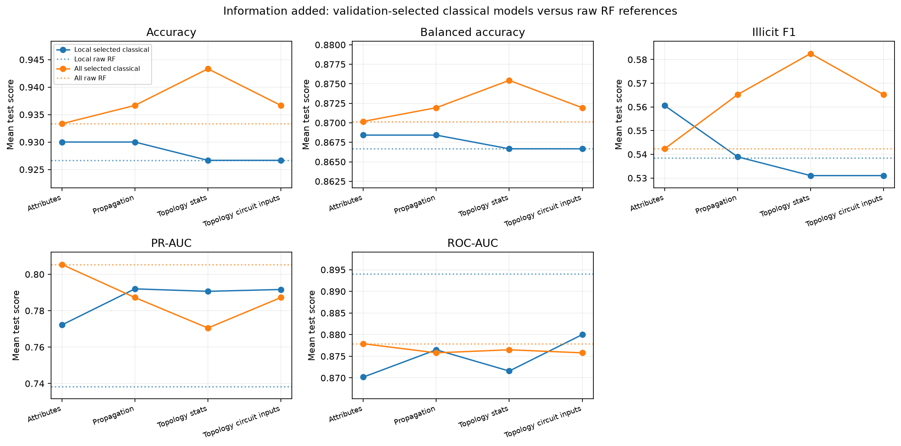
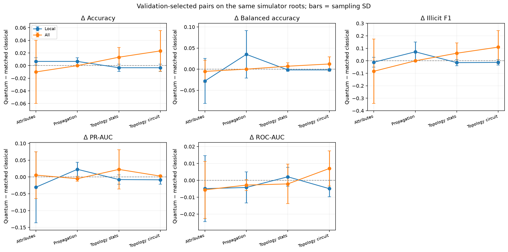
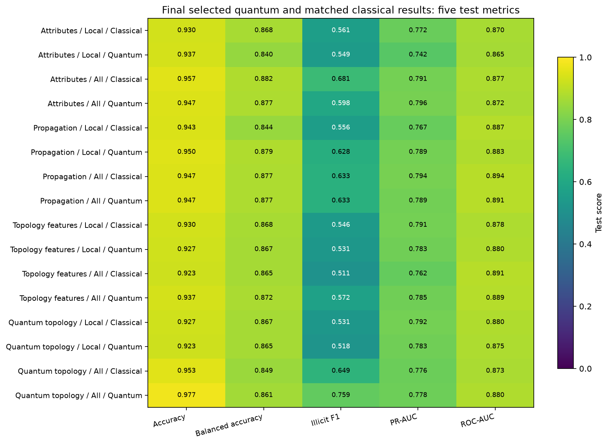

# Q-Ripple experiments

Can transaction-network structure help identify illicit transactions, and does a quantum representation add value beyond a matched classical model?

This repository extracts the Elliptic experiments into a self-contained notebook, reusable Python classes, recorded results and an independent Python environment. Start with [experiment_flow.ipynb](experiment_flow.ipynb). The directory and Git repository are named `q-ripple-experiements` as requested.

## Run locally

Python 3.12 is required. The local `.venv` belongs to this repository. From this directory:

```sh
uv sync --frozen
uv run python -m ipykernel install --prefix .venv --name q-ripple-experiements --display-name "Python (Q-Ripple Experiments)"
uv run jupyter lab experiment_flow.ipynb
```

Select **Python (Q-Ripple Experiments)**. `pyproject.toml` pins direct dependencies and `uv.lock` locks the complete dependency resolution. The environment, Jupyter kernel and raw CSVs are local files excluded from Git; code, experiment artifacts and figures are versioned.

The three Elliptic CSVs have already been copied into `data/` locally (about 665 MiB). A fresh Git checkout needs those files restored there; [data/manifest.json](data/manifest.json) records filenames, sizes and SHA-256 checksums. There is no dependency on the original experiment directory. `requirements.txt` provides a frozen pip-compatible export of the lockfile if uv is unavailable.

The notebook defaults to `REUSE_SAVED_RESULTS=True`: matching saved simulator configurations are restored and plots/tables regenerated. Set it to `False` to rerun all model fits and simulator sweeps, including after changing model implementations. Existing code-cell outputs remain available before execution.

## What was done, and why?

1. **Establish attribute references.** Compare Local 93 transaction features with All 165 features. All includes 72 supplied neighborhood aggregates, so it is not a purely local baseline. Raw RF and matched RBF/quantum kernels test how much these inputs already explain.
2. **Add seed-risk propagation.** Restore the earlier nine propagation descriptors, then sweep directional walk profiles through 1, 2, 3, 4, 6 and 8 hops. This asks whether known-risk exposure supplies useful additional information while retaining the original attributes.
3. **Describe topology numerically.** Compute motif/degree/walk and spectral descriptors on rooted subgraphs, with rooted WL as a stronger classical graph control. Compare RF, RBF and quantum kernels on the chosen descriptions. Quantum rotations on a summary cannot recover connectivity distinctions already discarded by that summary.
4. **Encode connectivity directly.** Let adjacency and root/seed markers determine Hamiltonian interactions, message-circuit edges or a Hermitian quantum-walk operator. Compare these quantum-derived similarities with a classical adjacency-RBF kernel on the same graph information. This tests a different representation of topology, not whether topology is exclusively quantum.
5. **Check physical execution.** Recover completed IBM Hamiltonian experiments to measure ideal/device discrepancies, observables and execution cost. Keep their small balanced classification cohort separate from simulator results.

The notebook explains the theory and visible steps before each experiment. Long loops, feature engineering, circuits, model fitting and plotting live in `elliptic_models/`. Full raw Local/All attributes and full-period propagation inputs bypass the approximate topology/kernel branch unchanged. This preserves those inputs for the RF; it does not make finite subgraph sampling, Nyström approximation or quantum encoding mathematically lossless.

**Nyström and re-uploading have different roles.** Nyström approximates a kernel using 12 training landmarks. Re-uploading feeds all input angles through repeated circuit rotations on four qubits. The attribute stage sweeps one/two passes with Nyström fixed; it is not a new complete exact-versus-Nyström factorial study. The reusable `ClassificationExperiment` also supports exact-kernel ablations, and earlier experiment tables are retained under `experiment_results/`.

## Evaluation and controls

- Train on time steps 1–30; select on 31–34; test on 35–49. All four simulator stages share the same non-seed roots: 80 train, 60 validation and 100 test for sampling seeds 42/43/44.
- Fit transforms and select landmarks on training data only. Mean validation AP selects configurations; the tables below then report mean test scores. Test scores do not choose the reported winners.
- Graph experiments retain unknown nodes, reveal a fixed 20% of period-local illicit labels as known seeds, and exclude seeds from evaluation in every stage. This is seed-assisted discovery with period connectivity available, rather than an online edge-arrival task.
- A matched quantum/classical pair shares roots, graph information/order, radius, node budget, landmarks, raw-input bypass and RF settings. The topology similarity function changes. The direct-topology counterpart is **RF + adjacency RBF**, not a classically simulated version of the same quantum function.
- The direct topology branch excludes numerical node attributes; these remain in the common raw-input bypass. Radius, retained-node budget and circuit depth are different parameters. Radius sweeps use eight nodes and four Hamiltonian steps. At fixed four-hop radius, simulator sweeps use Hamiltonian steps 1/2/4/8 and message layers 1/2/3/4. Hamiltonian steps refine a fixed-time product formula; message layers change the encoder.
- Subsection tables retain the best classical model, best quantum model and that quantum model's exact classical counterpart. The classical winner and the counterpart can differ. Full sweeps remain in CSVs and validation heatmaps rather than long printed tables.

**Metrics:** Accuracy measures overall correctness; balanced accuracy averages illicit and licit recall; illicit F1 combines positive-class precision and recall at the classifier's decision rule. PR-AUC here means **average precision (AP)**, not trapezoidal PR integration. ROC-AUC measures illicit-versus-licit ranking. All five are higher-is-better. Accuracy can hide imbalance, and AP depends on prevalence. AP SD/error bars reflect sampling variation across three seeds, not confidence intervals. The notebook gives formulas and references.

## Key simulator results

These rows are selected by validation AP. They are exploratory pilot results, not a full-data benchmark or evidence that each successive stage must improve every metric.

### Does added graph information help classically?

The first two rows are raw RF references. Subsequent rows are the validation-selected classical model in each subsection; architectures/settings can differ, so the progression is not a single-model feature ablation.

| Stage | Features | Model | Setting | Accuracy | Balanced accuracy | Illicit F1 | PR-AUC | ROC-AUC |
|---|---|---|---|---|---|---|---|---|
| Raw reference | Local | Raw RF | 93 attributes | 0.9267 | 0.8667 | 0.5385 | 0.7383 | 0.8940 |
| Raw reference | All | Raw RF | 165 attributes | 0.9333 | 0.8702 | 0.5423 | 0.8054 | 0.8779 |
| Attributes | Local | RF + RBF attributes | passes=1; Attributes | 0.9300 | 0.8684 | 0.5606 | 0.7722 | 0.8702 |
| Attributes | All | Raw RF | raw attributes | 0.9333 | 0.8702 | 0.5423 | 0.8054 | 0.8779 |
| Propagation | Local | RF + legacy propagation | 9 legacy features | 0.9300 | 0.8684 | 0.5390 | 0.7920 | 0.8765 |
| Propagation | All | RF + propagation | hops=6 | 0.9367 | 0.8719 | 0.5652 | 0.7872 | 0.8758 |
| Topology features | Local | RF + RBF topology features | hops=1; passes=2; Motifs | 0.9267 | 0.8667 | 0.5310 | 0.7906 | 0.8716 |
| Topology features | All | RF + spectra | hops=6; passes=2; Spectra | 0.9433 | 0.8754 | 0.5825 | 0.7705 | 0.8765 |
| Quantum topology | Local | RF + adjacency RBF | hops=1; steps=4; Hamiltonian fidelity quantum | 0.9267 | 0.8667 | 0.5310 | 0.7916 | 0.8800 |
| Quantum topology | All | RF + propagation | hops=6 | 0.9367 | 0.8719 | 0.5652 | 0.7872 | 0.8758 |



**Interpretation.** For Local 93, raw RF AP is **0.7383**, versus **0.7920** with legacy propagation, a gain of about **0.0537**. The strongest selected attribute-stage classical kernel already reaches **0.7722**, so the additional propagation gain relative to that reference is about **0.0198**. Selected motif and adjacency models remain around AP 0.791, without a further clear AP improvement. All 165 already includes neighborhood aggregates: its raw RF AP is **0.8054**, exceeding the validation-selected later-stage test APs in this pilot, even when later models improve accuracy or F1. The evidence supports useful graph context for Local, not a universal monotonic gain.

### Does the quantum representation improve its matched classical counterpart?

Every metric cell below is **classical → quantum**, using the selected quantum configuration and its exact counterpart. These classical rows need not be the best classical rows above. Full model names are in [06_summary_best_pairs.csv](results/experiment_flow/06_summary_best_pairs.csv).

| Stage | Features | Quantum setting | Accuracy | Balanced accuracy | Illicit F1 | PR-AUC | ROC-AUC |
|---|---|---|---|---|---|---|---|
| Attributes | Local | passes=1; Attributes | 0.9300 → 0.9367 | 0.8684 → 0.8404 | 0.5606 → 0.5493 | 0.7722 → 0.7417 | 0.8702 → 0.8653 |
| Attributes | All | passes=1; Attributes | 0.9567 → 0.9467 | 0.8825 → 0.8772 | 0.6815 → 0.5977 | 0.7905 → 0.7961 | 0.8772 → 0.8716 |
| Propagation | Local | hops=4; passes=1; Generic | 0.9433 → 0.9500 | 0.8439 → 0.8789 | 0.5556 → 0.6276 | 0.7667 → 0.7895 | 0.8870 → 0.8828 |
| Propagation | All | hops=4; passes=1; Generic | 0.9467 → 0.9467 | 0.8772 → 0.8772 | 0.6333 → 0.6333 | 0.7938 → 0.7887 | 0.8940 → 0.8912 |
| Topology features | Local | hops=1; passes=2; Spectra | 0.9300 → 0.9267 | 0.8684 → 0.8667 | 0.5457 → 0.5310 | 0.7911 → 0.7834 | 0.8779 → 0.8800 |
| Topology features | All | hops=3; passes=2; Spectra | 0.9233 → 0.9367 | 0.8649 → 0.8719 | 0.5110 → 0.5717 | 0.7622 → 0.7847 | 0.8912 → 0.8891 |
| Quantum topology | Local | hops=1; steps=4 | 0.9267 → 0.9233 | 0.8667 → 0.8649 | 0.5310 → 0.5183 | 0.7916 → 0.7832 | 0.8800 → 0.8751 |
| Quantum topology | All | hops=8; steps=4 | 0.9533 → 0.9767 | 0.8491 → 0.8614 | 0.6493 → 0.7591 | 0.7755 → 0.7781 | 0.8730 → 0.8800 |



**Interpretation.** Quantum gains are mixed. The selected propagation quantum model improves Local AP from **0.7667 to 0.7895**, while its All counterpart slightly decreases AP. Numerical spectral kernels likewise vary by feature set. Direct Hamiltonian encoding gives Local AP **0.7832 versus 0.7916** classically, and All AP **0.7781 versus 0.7755**. The All direct pair improves F1 substantially (**0.6493 → 0.7591**) while AP barely changes, illustrating why all five metrics matter. There is no consistent predictive quantum advantage in these results.



The structural graph probes test summary collisions and node-relabeling sensitivity separately from illicit classification. They can demonstrate a limitation of selected summaries, but spectral/WL controls may distinguish those graphs classically. A different quantum kernel heatmap alone is not evidence of better classification. Deterministic node ordering is not a canonical graph labeling. Archived ordering-robustness results use different cohorts/settings and are excluded from the current pilot winners.

## IBM hardware results and policy

**Most IBM runs are disabled. Only final direct quantum-topology hardware is enabled.** Earlier attribute, propagation and descriptor kernels are explored with simulators; the final physical experiment focuses the device budget on graph dynamics, routing, noise, shot uncertainty and cost. Simulator-derived quantum models are quantum feature maps even though a classical statevector simulator evaluates them.

Two completed jobs on `ibm_fez` are included: 148 eight-qubit fidelity circuits at 1,024 shots, and six 40-active-qubit observable circuits at 2,048 shots. Recorded total: **163,840 shots and 52 charged QPU seconds**. The manifest and measurement counts are copied, allowing local analysis without IBM credentials or new submissions. The final notebook method recovers these jobs; if its recorded manifest is missing/incomplete and hardware remains enabled, it can submit missing groups using an externally saved IBM account. Set `HARDWARE['quantum_topology']=False` to prevent submissions in that case.

The separate balanced hardware cohort has 12 train / 8 validation / 12 test examples. Its scores are **not directly comparable** with the natural-prevalence simulator cohorts.

| Model | Accuracy | Balanced accuracy | Illicit F1 | PR-AUC | ROC-AUC |
|---|---|---|---|---|---|
| Classical topology RBF | 0.6667 | 0.6667 | 0.7143 | 0.8135 | 0.7639 |
| Ideal Hamiltonian | 0.6667 | 0.6667 | 0.7143 | 0.8135 | 0.7639 |
| IBM Hamiltonian | 0.6667 | 0.6667 | 0.7143 | 0.9444 | 0.9167 |
| Raw + propagation RF | 0.6667 | 0.6667 | 0.7143 | 0.6190 | 0.5972 |

**Interpretation.** Measured AP is higher on this tiny test cohort, while accuracy, balanced accuracy and F1 are identical across the four models. Structural-kernel mean absolute error is about **0.438**, indicating substantial ideal/device disagreement; the measured AP is not reliable evidence of predictive advantage. The 40-node runs compare directed, reversed and edgeless graph observables, with shot standard errors and an analytic edgeless reference. No full 40-qubit statevector was evaluated, and alternative classical simulation methods were not benchmarked.

Credentials are not part of this repository or environment. New hardware work uses a Qiskit account saved outside the repository.

## Repository contents

| Path | Purpose |
|---|---|
| `experiment_flow.ipynb` | Main research notebook, explanations, executed results and figures |
| `elliptic_models/experiment_flow.py` | Stage orchestration, selection, CSV exports and interpretation |
| `elliptic_models/` | Loading, metrics, propagation, graph sampling, classical/quantum kernels, encoders and hardware recovery |
| `results/experiment_flow/` | Current simulator fits, cohort identities, selected comparisons, diagnostics and PNG/SVG figures |
| `experiment_results/` | Earlier result tables plus completed IBM inputs, counts, kernels and manifests |
| `tests/` | Model/control/metric/selection/portability-related checks; no cloud jobs |
| `data/` | Local raw CSVs (ignored by Git), tracked input manifest and restoration instructions |
| `pyproject.toml`, `uv.lock`, `requirements.txt` | Independent pinned Python environment |
| `provenance.json` | Extraction source and packaging changes |

[Result index](results/experiment_flow/result_index.csv) lists current CSV exports. `*_all.csv` contains full simulator configurations, `*_aggregate.csv` their means, `*_pairs.csv` per-seed paired differences, and `*_best*.csv` selected reports. Heatmap CSVs retain their plotted values. Classification tables use all five core metrics; structural diagnostics instead use similarity/error measures appropriate to their task.

## Validation and limitations

Validated in this repository’s independent `.venv`: **42 tests passed**, and **all 14 notebook code cells executed without errors**, reusing saved simulator fits and completed IBM jobs.

Run checks from this repository root:

```sh
MPLBACKEND=Agg uv run python -m unittest discover -s tests -v
```

Checks cover seed exclusion and root alignment, unchanged raw-input prefixes, legacy-feature equivalence, train-only preprocessing, quantum/classical pairing, graph/Hamiltonian conventions, product-formula convergence, summary collisions, CSV selection and plotting. They do not access IBM services. The notebook can also regenerate its displayed results entirely from the copied simulator fits and completed measurement artifacts.

The cohorts are small, sampling SD is substantial, configurations were explored repeatedly and there is no untouched confirmatory holdout. Seed availability and full-period connectivity are explicit assumptions. Finite node budgets truncate graphs; Nyström and observable readouts introduce approximations. The RF may obtain most of its predictive power from the unchanged classical branch. Larger cohorts, repeated validation, stronger tuned classical graph baselines and an independent final test are needed before drawing a stronger predictive or computational claim.
